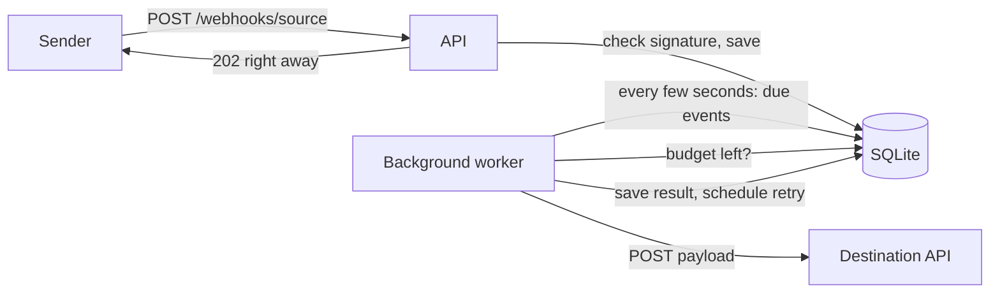

# Webhook Relay

[](https://github.com/SamaadTurner/webhook-relay/actions/workflows/ci.yml)

A small ASP.NET Core service that receives webhooks, saves them, and forwards them
to another API. It is built around three problems I kept running into with webhook
integrations at work:

1. **Senders retry, so the same webhook arrives twice.** Each delivery is saved once
   and repeats are ignored.
2. **The destination goes down.** Events wait in a queue and are retried with a
   growing delay. After too many failures they are marked failed and can be replayed.
3. **The destination has a daily call limit.** The relay keeps a daily budget in the
   database, stops when it is spent, and carries on the next day.

This is a personal project written from scratch. It does not contain any code or data
from my job.

## How it works



1. A sender posts to `/webhooks/{source}` with a delivery ID and an HMAC signature.
2. The API checks the signature against the raw body, saves the event as `Pending`,
   and returns `202`. It does not wait for the destination.
3. A background worker wakes up every few seconds and picks up events that are due.
4. For each one it first takes one call out of today's budget, then posts the payload
   to the destination.
5. A `2xx` answer marks the event `Delivered`. Anything else schedules a retry
   (30s, 60s, 120s, ... capped at an hour). After 5 failed attempts it is `Failed`.

## Run it locally

You need the [.NET 10 SDK](https://dotnet.microsoft.com/download). Nothing else.
The database is a SQLite file that is created on first start.

```bash
git clone https://github.com/SamaadTurner/webhook-relay.git
cd webhook-relay
dotnet run --project src/WebhookRelay.Api --launch-profile http
```

In Development the app includes a fake destination at `/dev/destination` and forwards
to itself, so you can watch the whole flow on one machine.

Send a signed test webhook (needs `bash`, `curl` and `openssl`):

```bash
./scripts/send-webhook.sh order-1 '{"order":1}'
# HTTP/1.1 202 Accepted
# {"id":1,"duplicate":false}

./scripts/send-webhook.sh order-1 '{"order":1}'
# HTTP/1.1 200 OK
# {"id":1,"duplicate":true}
```

A couple of seconds later the worker has delivered it:

```bash
curl -H "X-Api-Key: dev-admin-key" http://localhost:5116/stats
# {"pending":0,"delivered":1,"failed":0,"callsUsedToday":1,"dailyCallBudget":1000}

curl -H "X-Api-Key: dev-admin-key" http://localhost:5116/events/1
```

The keys in `appsettings.Development.json` (`dev-admin-key`, `dev-secret`) are for
local use only. Real values come from environment variables.

### With Docker

```bash
cp .env.example .env   # then edit it
docker compose up --build
```

The API listens on port 8080 and the database sits on a named volume.

## Endpoints

| Method and path | Auth | What it does |
|---|---|---|
| `POST /webhooks/{source}` | Signature | Saves the event and returns `202`. A repeated delivery ID returns `200` and saves nothing |
| `GET /events?status=&source=&page=&pageSize=` | API key | Lists events, newest first |
| `GET /events/{id}` | API key | One event with its payload and every delivery attempt |
| `POST /events/{id}/replay` | API key | Puts a failed event back in the queue |
| `POST /backfill` | API key | Queues every finished event in a date range to be sent again |
| `GET /stats` | API key | Counts by status and how much of today's budget is used |
| `GET /health` | None | `Healthy` if the app and database are up |

Webhook requests need two headers:

- `X-Delivery-Id`: the sender's ID for this delivery
- `X-Signature-256`: `sha256=` followed by the hex HMAC-SHA256 of the raw body, using
  the secret configured for that source

Admin requests need `X-Api-Key`. Backfill body:

```json
{ "from": "2026-03-01T00:00:00Z", "to": "2026-04-01T00:00:00Z", "source": "demo" }
```

## Settings

Everything is under `Relay` in `appsettings.json`. Environment variables override it,
with `__` between levels (for example `Relay__DailyCallBudget=500`).

| Setting | Default | Meaning |
|---|---|---|
| `DestinationUrl` | (none) | Where events are forwarded |
| `AdminApiKey` | (none) | Key for the admin endpoints. If it is empty they all return `401` |
| `Sources:{name}:Secret` | (none) | Signature secret for each sender |
| `DailyCallBudget` | 1000 | Most calls to the destination per UTC day |
| `MaxAttempts` | 5 | Tries before an event is marked `Failed` |
| `BaseDelaySeconds` | 30 | Wait before the first retry. Doubles each time |
| `MaxDelaySeconds` | 3600 | Longest wait between retries |
| `PollIntervalSeconds` | 5 | How often the worker looks for work |
| `BatchSize` | 20 | Events picked up per look |

## Tests

```bash
dotnet test
```

68 tests, all run in CI on every push:

- **Unit tests** for the signature check and the retry delay.
- **Delivery tests** that run the real delivery code against an in-memory SQLite
  database, a fake destination, and a fake clock. The fake clock is what lets a test
  say "30 seconds later" or "the next day" without waiting.
- **API tests** that start the whole app in memory with `WebApplicationFactory` and
  call it over HTTP.

## Decisions and trade-offs

**Why answer `202` before forwarding?** Most senders give up after a few seconds and
send the webhook again. If the relay waited on a slow destination, the sender would
time out and retry, and the problem would get worse. Saving first means the only
thing that can make the sender wait is the relay's own database.

**Why a database table and not a message queue?** For one small service, a table is
enough and there is one less thing to run. The event is saved in the same place the
status is tracked, and it is easy to look at with a query. A real queue would make
sense with much higher volume or more than one consumer.

**Why SQLite?** It needs no setup, so the project runs from a clean clone with one
command. The cost is that only one copy of the app can run. See "What I would change"
below.

**What happens if the app crashes mid-delivery?** If it dies after the destination
got the event but before the result was saved, the event is still `Pending` and will
be sent again on restart. So delivery is "at least once", not "exactly once". The
relay sends the original delivery ID in the `X-Relay-Delivery-Id` header so the
destination can ignore one it has already handled.

**Why is the budget in the database?** If it were a counter in memory, a restart in
the afternoon would reset it to zero and the relay could go over the limit. A call is
also counted before it is made. A crash can make the count one too high, but never
too low, which is the safe direction when the limit belongs to someone else.

**Failed calls count against the budget.** The destination counts every request it
receives, not just the ones that succeed, so the relay does too.

**Admin endpoints are locked when no key is set.** Leaving them open by default would
be easy to miss in a deployment.

## What I would change for real production use

- **Run more than one worker.** Two workers would currently pick up the same events.
  With PostgreSQL the worker query could use `FOR UPDATE SKIP LOCKED` so each event
  goes to one worker. The budget update would need to be a single
  `UPDATE ... WHERE calls_used < limit` so two workers can't both take the last call.
- **Run migrations as a deploy step** and not on startup.
- **Per-destination routing.** Right now every source forwards to one URL.
- **Clean up old events.** Delivered events are kept forever.
- **Metrics and alerts** on the failed count and on the budget running low.

## Project layout

```
src/WebhookRelay.Api/
  Controllers/   webhook intake, admin endpoints, API key check
  Services/      signature check, retry delay, daily budget, delivery, worker
  Models/        database classes and API responses
  Data/          EF Core context and migrations
tests/WebhookRelay.Tests/
scripts/send-webhook.sh
```

## License

MIT
